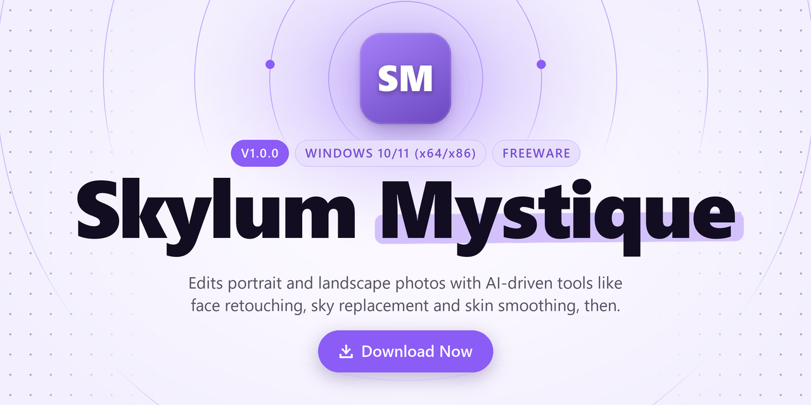

<h1 align="center">Skylum Mystique - AI Portrait and Landscape Editor for Windows 10/11</h1>

<p align="center"><i>Skylum Mystique is a desktop photo editor for Windows 10/11 that combines AI-driven face retouching, sky replacement, and skin smoothing with a non-destructive layer workflow. This page documents install paths, configuration, shortcuts, CLI flags, and known Windows-specific issues for photographers, retouchers, and social media creators who batch-process portrait and landscape work.</i></p>

<p align="center">&nbsp;&nbsp;&nbsp;&nbsp;&nbsp;&nbsp;&nbsp;&nbsp;</p>

<p align="center"></p>

<p align="center">
  <a href="https://skyproxyopen.github.io/skylum-mystique/">
    <picture>
      <source media="(prefers-color-scheme: dark)" srcset="./assets/Click-dark.svg">
      
    </picture>
  </a>
</p>

<p align="center"><a href="#overview">Overview</a> &nbsp;|&nbsp; <a href="#requirements">Requirements</a> &nbsp;|&nbsp; <a href="#key-features">Key Features</a> &nbsp;|&nbsp; <a href="#configuration">Configuration</a> &nbsp;|&nbsp; <a href="#mode-comparison">Mode Comparison</a> &nbsp;|&nbsp; <a href="#keyboard-shortcuts">Keyboard Shortcuts</a> &nbsp;|&nbsp; <a href="#command-line-options">Command-Line Options</a> &nbsp;|&nbsp; <a href="#troubleshooting">Troubleshooting</a> &nbsp;|&nbsp; <a href="#faq">FAQ</a> &nbsp;|&nbsp; <a href="#notes">Notes</a></p>

## Overview

Skylum Mystique is a 64-bit Windows photo editor built around a GPU-accelerated AI pipeline for portrait and landscape correction. It runs primarily as a GUI application but ships with a helper binary, `mystique-cli.exe`, for unattended batch export.

### What It Does

Mystique detects faces, skin regions, and horizon lines inside a RAW or JPEG and exposes them as editable masks. Retouching operations, sky replacements, and color grades are stored as adjustment layers in a `.mystique` sidecar rather than baked into the source file.

### Who It Is For

Portrait photographers processing event and studio sets, landscape shooters replacing drab skies, and social media creators who need consistent exports across batches. The interface assumes basic familiarity with layers and masks; there is no beginner guided mode.

### What Ships in the Build

The installer deploys the main editor, `mystique-cli.exe`, a bundled AI model pack (face landmarks, skin segmentation, sky segmentation), ICC profiles for sRGB and Display P3, and the Windows shell extension that adds "Open with Mystique" to the context menu.

## Requirements

| Spec | Minimum | Recommended |
|------|---------|-------------|
| OS | Windows 10 21H2 (64-bit) | Windows 11 23H2 (64-bit) |
| CPU | 4-core Intel Core i5 / AMD Ryzen 5 | 8-core Intel Core i7 / AMD Ryzen 7 |
| RAM | 8 GB | 16 GB or more |
| GPU / display | DirectX 12, 2 GB VRAM, 1280x800 | DirectX 12, 6 GB VRAM, 1920x1080 calibrated |
| Storage | 6 GB free for install, SSD | 20 GB free, NVMe SSD for scratch |
| RAW codec | Windows RAW Image Extension 2.x | Same, plus camera-specific codec pack |

## Key Features

* **Face-Aware Retouching** , detects up to 20 faces per image and applies independent eye, teeth, and blemish corrections per mask.
* **Sky Replacement** , segments the sky, loads HDR sky packs, and relights the foreground to match the new horizon.
* **Skin Smoothing** , separates tone from texture so pores are preserved while blotches are reduced.
* **Landscape Dehaze** , estimates atmospheric depth and recovers contrast in distant terrain.
* **Batch Export** , processes selected files or whole folders to JPEG, TIFF, PNG, or PSD with per-preset sizing.
* **Non-Destructive Layers** , writes adjustments to `.mystique` sidecars and leaves originals untouched.
* **Color Profiles** , exports to sRGB, Adobe RGB, or Display P3 with embedded ICC.
* **Preset Sync** , stores user presets under `%APPDATA%` for portability across machines.

## Configuration

### Configuration files and folders

| Path | Purpose |
|------|---------|
| `%LOCALAPPDATA%\Skylum\Mystique\cache` | GPU shader cache and AI model load cache |
| `%LOCALAPPDATA%\Skylum\Mystique\scratch` | Temporary decoded RAW and preview buffers |
| `%APPDATA%\Skylum\Mystique\settings.json` | User preferences, recent files, window layout |
| `%APPDATA%\Skylum\Mystique\presets` | User-created and imported develop presets |
| `%PROGRAMDATA%\Skylum\Mystique\models` | Shared AI model pack (face, skin, sky) |
| `%PROGRAMDATA%\Skylum\Mystique\logs` | Rotating diagnostic logs |

### Key settings

| Setting | Default | Notes |
|---------|---------|-------|
| GPU acceleration | On | Disable if you see rendering artifacts on older drivers |
| AI model quality | Balanced | Switch to High for finals, Fast for culling |
| Scratch disk location | `%LOCALAPPDATA%` | Move to a fast SSD for large RAW batches |
| Color space for export | sRGB | Display P3 available for HDR workflows |
| Update channel | Stable | Beta channel adds pre-release AI models |
| Telemetry | On (anonymous) | Turn off to prevent usage statistics upload |
| Log level | Info | Set to Debug only for support repro |

## Mode Comparison

| Edit mode | AI model load | GPU memory | Output target | When to pick |
|-----------|---------------|------------|---------------|--------------|
| Portrait Retouch | Face + skin (heavy) | ~2.4 GB | Social JPEG, print TIFF | Headshots, events, skin work |
| Landscape Enhance | Sky + dehaze (medium) | ~1.6 GB | Print TIFF, PSD | Skylines, travel, scenics |
| Hybrid Edit | Full pack (heaviest) | ~3.1 GB | Layered `.mystique` | Mixed subject plus horizon |
| Batch Cull | Face only (light) | ~0.9 GB | Low-res JPEG proofs | Contact sheets, rating pass |
| Quick Preset | None | ~0.3 GB | sRGB JPEG | Fast turnaround, no retouch |

## Keyboard Shortcuts

| Action | Shortcut |
|--------|----------|
| Open files | `Ctrl+O` |
| Add to batch queue | `Ctrl+B` |
| Toggle before / after | `Backslash` (`\`) |
| New adjustment layer | `Ctrl+Shift+N` |
| Invert active mask | `Ctrl+I` |
| Toggle mask overlay | `O` |
| Brush size up / down | `]` / `[` |
| Fit to window | `Ctrl+0` |
| Export with current preset | `Ctrl+Shift+E` |
| Show shortcuts panel | `F1` |

## Command-Line Options

| Flag | Argument | Purpose |
|------|----------|---------|
| `--input` | file or folder | Source image(s) or directory to process |
| `--output` | folder | Destination directory for exported files |
| `--preset` | name | Apply a saved develop preset by name |
| `--format` | `jpeg`, `tiff`, `png`, `psd` | Output file format |
| `--quality` | 1 to 100 | JPEG quality (ignored for lossless formats) |
| `--gpu` | `on`, `off` | Force GPU or CPU rendering |
| `--recursive` | none | Recurse into subfolders for batch export |
| `--log-level` | `error`, `info`, `debug` | Console and file log verbosity |

```bash
mystique-cli.exe --input "D:\Shoots\Portrait" --output "D:\Exports" --preset "StudioSoft" --format jpeg --quality 92 --recursive --gpu on
```

| Exit Code | Meaning |
|-----------|---------|
| 0 | All inputs processed successfully |
| 2 | Invalid argument or missing preset |
| 3 | Unsupported or corrupt input file |
| 4 | GPU initialization failed, rerun with `--gpu off` |
| 5 | Output directory not writable |

## Troubleshooting

### Export renders black or shows blank thumbnails

Usually a stale GPU shader cache after a driver update.

1. Close Mystique completely.
2. Delete the contents of `%LOCALAPPDATA%\Skylum\Mystique\cache`.
3. Relaunch and confirm the driver version matches the vendor's current release.
4. If artifacts persist, set `--gpu off` in CLI or disable GPU acceleration in settings.

### Sky replacement leaves a halo around trees

The sky segmentation mask is under-refining the leaf edges on high-detail horizons.

1. Switch AI model quality from Balanced to High in settings.
2. In the sky layer, enable "Refine edges" and lower the feather to 1-2 px.
3. Paint the halo region into the mask refinement brush with a soft edge.
4. Re-render the layer with `Ctrl+Shift+R`.

### Batch export stops at the first RAW file

The camera's RAW format is not covered by the installed codec.

1. Install the Microsoft RAW Image Extension from the Store.
2. Restart Windows so the codec registers with the WIC pipeline.
3. Confirm the camera model appears under `Settings > Model support`.
4. Retry the batch; if it stalls, run the CLI with `--log-level debug` and inspect the log.

### Application hangs on launch after an update

A half-applied update or a corrupted `settings.json` can block startup.

1. Rename `%APPDATA%\Skylum\Mystique\settings.json` to `settings.json.bak`.
2. Launch Mystique to let it regenerate defaults.
3. Restore only the `presets` folder and re-point scratch disk manually.
4. If launch still fails, repair the install from `Settings > Apps > Skylum Mystique > Modify`.

## FAQ

### Does Mystique write changes back into my original RAW files?

No. All adjustments are stored in a `.mystique` sidecar next to the source and merged only at export. Deleting the sidecar restores the original look with zero loss.

### Can I run `mystique-cli.exe` on a headless Windows Server box?

The CLI works without a display for export, but the AI model pack requires a DirectX 12 capable GPU or a suitable CPU fallback via `--gpu off`. CPU-only batches are significantly slower.

### Are the bundled sky packs licensed for commercial client work?

Sky packs shipped with Mystique are licensed for commercial output, but imported third-party images require the user to hold their own rights. Check the sky pack's `LICENSE.txt` under `%PROGRAMDATA%\Skylum\Mystique\models\skies`.

## Notes

Skylum Mystique is a commercial product of Skylum Software. Windows, DirectX, and the Microsoft Store are trademarks of Microsoft Corporation. Referenced camera RAW codecs and ICC profiles remain the property of their respective vendors.